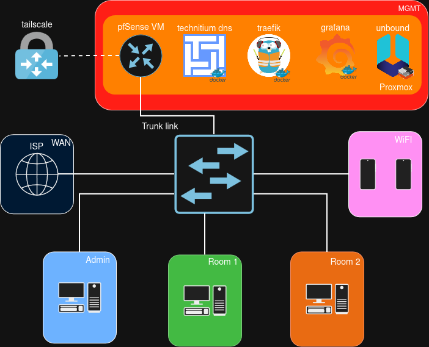
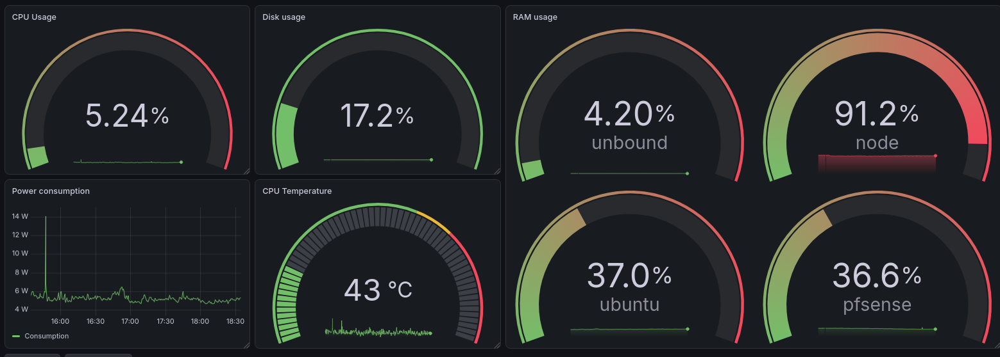
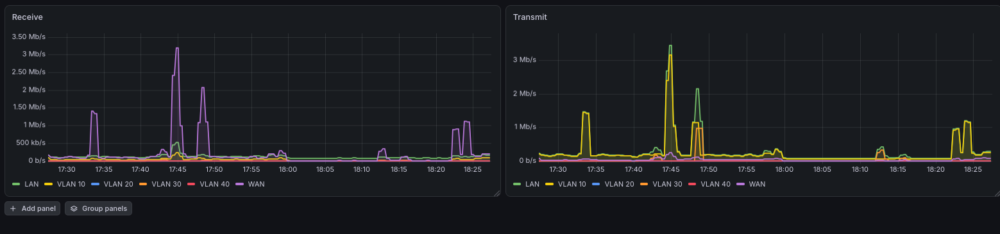

[English](README.md) | **Русский**

# Моя homelab
Этот репозиторий описывает мою домашнюю лабораторию (homelab) на базе Proxmox VE, pfSense и Docker.

## Оглавление

* [Сеть](#сеть)
  * [Диаграмма](#диаграмма)
  * [VLAN и подсети](#vlan-и-подсети)
  * [Межсетевой экран](#межсетевой-экран)
  * [DNS](#dns)
* [Proxmox](#proxmox)
  * [Железо](#железо)
  * [Виртуальные машины и контейнеры](#виртуальные-машины-и-контейнеры)
  * [Резервное копирование](#резервное-копирование)
* [Сервисы](#сервисы)
* [Мониторинг и оповещения](#мониторинг-и-оповещения)
  * [Дашборд](#дашборд)
  * [Оповещения](#оповещения)

## Сеть
### Диаграмма

### VLAN и подсети

| id | Название   | Подсеть          |
| --- | ------ | ---------------- |
| 10  | Admin  | 192.168.10.0/24  |
| 20  | Room 1 | 192.168.20.0/24  |
| 30  | Room 2 | 192.168.30.0/24  |
| 40  | Wi-Fi  | 192.168.40.0/24  |
| 99  | MGMT   | 192.168.99.0/24  |
| 100 | WAN    | 192.168.100.0/24 |
### Межсетевой экран

| Откуда \ Куда   | MGMT     | Admin | Room 1/2 | Wi-Fi | Интернет |
| --------------- | -------- | ----- | -------- | ---- | -------- |
| Admin           | ✔        | -     | ✔        | ✔    | ✔        |
| Room 1/2     | только DNS | ✘     | ✘        | ✘    | ✔        |
| Wi-Fi           | только DNS | ✘     | ✘        | -    | ✔        |
| VPN (Tailscale) | ✔        | ✘     | ✘        | ✘    | ✔        |
### DNS
Основной DNS работает на Technitium, запущенном в Docker. Резервный — Unbound, работающий в LXC-контейнере Alpine. [unbound.conf](unbound/unbound.conf)

Для автоматизации создания DNS-записей я написал Python-скрипт [dns-sync](docker/dns-sync/sync.py), который считывает правила роутера из Traefik и создаёт записи через API Technitium.

## Сервисы

| Сервис | Описание | Compose-файл |
|---------|-------------|--------------|
| **Portainer** | Веб-интерфейс для управления Docker | [Compose](docker/portainer.yaml) |
| **Traefik** | Реверс-прокси. ACME настроен через Cloudflare | [Compose](docker/traefik/compose.yaml) |
| **Technitium** | DNS-сервер. Настроен на блокировку рекламных и вредоносных доменов | [Compose](docker/technitium.yaml) |
| **Grafana и VictoriaMetrics** | Стек мониторинга на базе Grafana, Loki, Alloy и VictoriaMetrics | [Compose](docker/monitoring/compose.yaml) |
| **n8n** | Инструмент автоматизации без написания кода | [Compose](docker/n8n.yaml) |
| **dns-sync** | Автоматизация DNS-записей | [Compose](docker/dns-sync/compose.yaml) |

## Proxmox
### Железо
**Xiaomi Notebook Pro 2019**
- Intel i5-8250U 1.60GHz, 4 ядра / 8 потоков
- 8 ГБ ОЗУ
- SSD 256 ГБ

**Второй узел**
- Ryzen 5 1400 3.20GHz, 4 ядра / 8 потоков
- 16 ГБ ОЗУ
- SSD 512 ГБ
- HDD 1024 ГБ
- Назначение: только резервные копии
### Виртуальные машины и контейнеры
- pfSense (VM)
- Ubuntu (VM)
- Alpine (LXC)
- PBS (LXC) (второй узел)
### Резервное копирование
Резервные копии создаются каждый день с помощью Proxmox Backup Server (PBS) и хранятся на втором узле.
Хранится одна ежедневная, одна еженедельная и одна ежемесячная копии.
## Мониторинг и оповещения
Мониторинг построен на Grafana (Grafana, Alloy, Loki) и VictoriaMetrics.
### Дашборд
Метрики Proxmox, виртуальных машин и LXC-контейнеров.

Метрики pfSense.

### Оповещения
| # | Правило оповещения |
|---|-----------|
| 1 | Высокое использование ОЗУ на ubuntu |
| 2 | Заканчивается место на диске |
| 3 | Цель недоступна |
